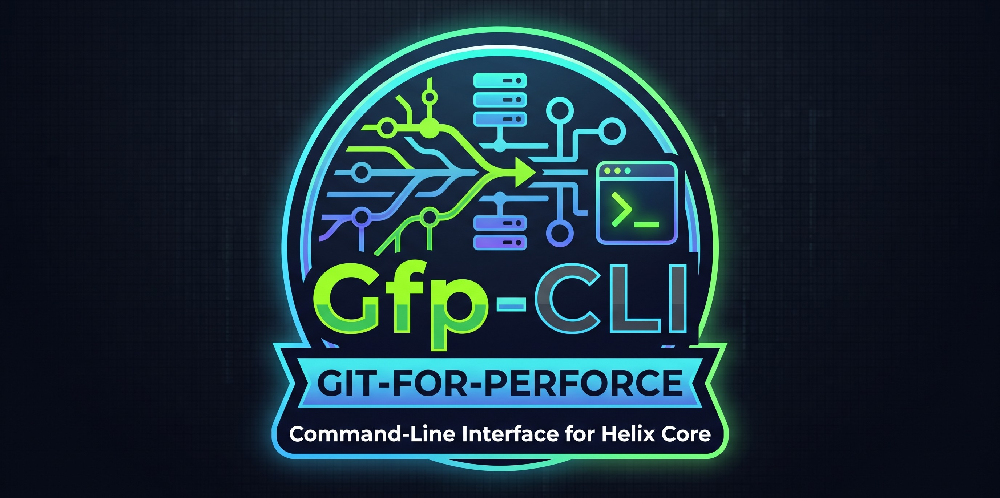
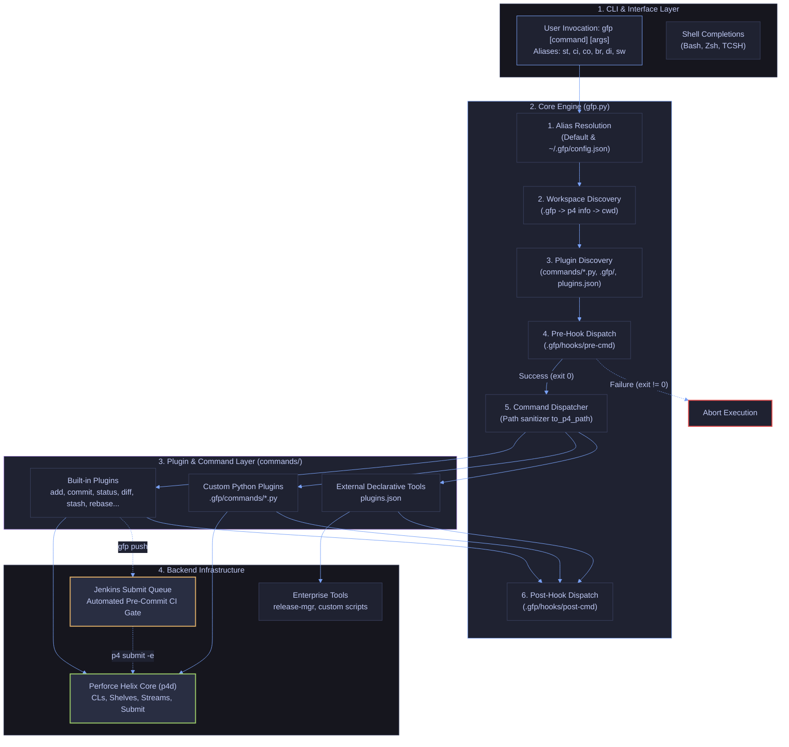
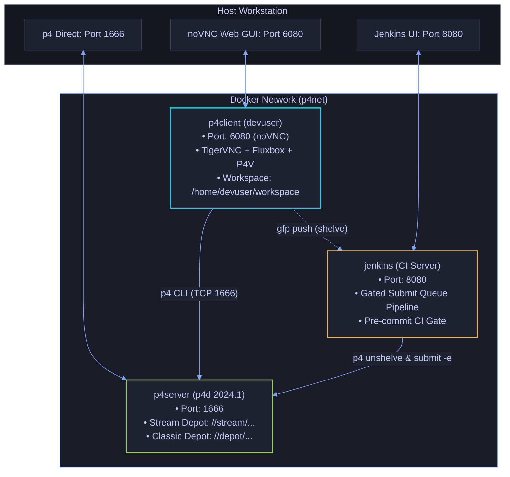
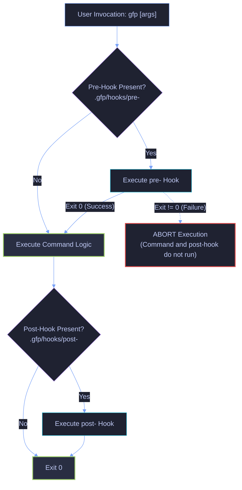

# Gfp-CLI: Git-Compatible CLI Layer for Perforce Helix Core

[](https://www.python.org/)
[](./LICENSE)
[](./commands/README.md)
[](./tests/README.md)
[](./BUG-TICKETS.md)

`gfp` is a modular, extensible command-line wrapper that translates standard Git workflows, mental models, and lifecycle hooks into native Perforce Helix Core (`p4`) operations.

> [!TIP]
> Looking for an interactive terminal UI dashboard?\
> Coming Soon, `LazyGfp`, the Git-compatible TUI wrapper for Helix Core.

---

## 1. Documentation Routing Table & System Architecture

### 1.1 Central Documentation Routing Table

The repository documentation is organized as an interconnected Document Network. Navigate directly to specialized documents below:

| Archetype                  | Document                                       | Primary Scope & Contents                                                                                  | Target Audience                      |
| :------------------------- | :--------------------------------------------- | :-------------------------------------------------------------------------------------------------------- | :----------------------------------- |
| **Root Landing Hub**       | [`./README.md`](./README.md)                   | Central switchboard, installation bootstrap, command matrix, and architecture big picture.                | All Developers, Architects, DevOps   |
| **Workflow Runbook**       | [`./README_WORKFLOW.md`](./README_WORKFLOW.md) | Step-by-step Git-to-Perforce development recipes, work-in-progress checkpointing, and branch workflows.   | Everyday Contributors, Git Migrators |
| **Subsystem Gateway**      | [`./commands/README.md`](./commands/README.md) | Built-in command module catalog, plugin interface contract, argument translation, and extension guide.    | Tool Developers, Plugin Authors      |
| **Toolchain Runbook**      | [`./docker/README.md`](./docker/README.md)     | Docker Compose playground, multi-container p4d/p4v/jenkins services, and Makefile targets.                | Verification Engineers, DevOps       |
| **Test Strategy**          | [`./tests/README.md`](./tests/README.md)       | Two-tier test architecture (Zero-dependency Unit suite & Live Perforce 36-scenario integration suite).    | Verification Engineers, QA           |
| **Verification Catalog**   | [`./tests/TESTS.md`](./tests/TESTS.md)         | Test-by-test specifications adhering to Goal, Description, Test-Flow, and Check schemas.                  | QA Engineers, Test Authors           |
| **Defect Registry**        | [`./BUG-TICKETS.md`](./BUG-TICKETS.md)         | Formal tracking of production code defects vs. test harness defects with verified root-cause resolutions. | Developers, QA, AI Agents            |
| **Operational Invariants** | [`./AGENTS.md`](./AGENTS.md)                   | Strict coding invariants, Python 3.6.4+ constraints, task routing tables, and naming conventions.         | Human Contributors, AI Agents        |

---

### 1.2 How Everything Connects

`gfp` bridges the UX gap between Git's distributed model and Perforce's centralized, changelist-based architecture without requiring third-party server modifications or daemon processes:



---

### 1.3 Key Architectural Capabilities

- **Git Parity:** Execute familiar commands (`status`, `add`, `commit`, `diff`, `log`, `pull`, `push`, `stash`, `checkout`, `blame`, `branch`, `switch`, `clean`, `clone`, `reopen`, `resolve`, `restore`).
- **Zero-Touch Core:** Add new commands as standalone Python scripts or JSON mappings without modifying [`./gfp.py`](./gfp.py).
- **Deterministic Lifecycle Hooks:** Custom executable scripts run before (`pre-*`) and after (`post-*`) any command, matching Git's hook semantics and aborting execution on non-zero exit codes.
- **Path & Wildcard Translation:** Automatically translates Git-style relative paths (`.`, `./`, directory paths) into Perforce wildcard syntax (`...`) and escapes special characters (`@`, `#`, `%`, `*`).
- **Terminal Paging Invariant:** Automatically routes large diff, log, show, and blame outputs through `$PAGER` or `less -FRX`, with robust broken-pipe signal handling.
- **Built-in Shell Completion:** Native tab-completion support for Bash, Zsh, and TCSH.
- **Self-Contained Docker Playground:** Ready-to-run container environment with Perforce Helix Core (`p4d`), P4V GUI (via noVNC), Jenkins gated submit-queue CI, and an automated 36-scenario integration test suite.

---

## 2. Directory Structure

```text
gfp-cli/
├── LICENSE                   # Open-source Apache 2.0 License
├── Makefile                  # Root orchestration: linting, formatting, staged test runners
├── pyproject.toml            # PEP 517/621 packaging metadata, ruff, mypy & pytest configs
├── README.md                 # Root landing hub, documentation router, and command matrix
├── README_WORKFLOW.md        # Everyday Git-to-Perforce workflows and mental models
├── BUG-TICKETS.md            # Centralized defect registry and triage tickets
├── AGENTS.md                 # Project invariants, task routing, and style guide for AI/contributors
├── utils.py                  # Centralized Perforce, path escaping, and terminal pager utilities
├── gfp.py                    # Core CLI engine, workspace resolution, hook dispatcher, and plugin loader
├── commands/                 # Built-in command plugins subsystem gateway
│   ├── README.md             # Subsystem architecture, plugin contract, and command walkthrough
│   ├── add.py                # Stages/opens files for add, edit, delete, or reconcile
│   ├── blame.py              # Line attribution history viewer (p4 annotate)
│   ├── branch.py             # Stream/branch listing, creation, and deletion (p4 streams)
│   ├── checkout.py           # Discards local modifications (p4 revert)
│   ├── clean.py              # Removes untracked and unreconciled files from workspace (p4 clean)
│   ├── clone.py              # Clones depot/stream into a directory & sets up client workspace (p4 client & p4 sync)
│   ├── commit.py             # Creates or amends numbered pending changelists (p4 change -i)
│   ├── completion.py         # Shell completion script generator (bash, zsh, tcsh)
│   ├── diff.py               # Unified diff against depot head or changelist (p4 diff -du)
│   ├── log.py                # Changelist history viewer (p4 changes -m N -l)
│   ├── pull.py               # Syncs depot revisions and auto-resolves changes (p4 sync && p4 resolve -am)
│   ├── push.py               # Submits pending changelists to depot (p4 submit)
│   ├── rebase.py             # Rebase, squash, or interactively manipulate pending changelists
│   ├── reopen.py             # Moves opened files between changelists (p4 reopen)
│   ├── resolve.py            # Conflict resolution between workspace and depot revisions (p4 resolve)
│   ├── restore.py            # Restores working tree files or purges pending changelists (p4 revert / p4 change -d)
│   ├── show.py               # Changelist details and unified diff viewer (p4 describe -du)
│   ├── stash.py              # Shelves and unshelves pending changelists (p4 shelve / p4 unshelve)
│   ├── status.py             # Workspace status audit for opened and untracked files
│   └── switch.py             # Switches client workspace stream (p4 switch)
├── completions/              # Autocompletion definitions
│   ├── _gfp                  # Zsh completion definition
│   ├── gfp.bash              # Bash completion script
│   └── gfp.tcsh              # TCSH completion definition
├── man/                      # UNIX manual pages (troff/groff)
│   └── man1/
│       ├── gfp.1             # Main CLI manual page
│       ├── gfp-commit.1      # Commit command manual page
│       ├── gfp-push.1        # Push and gated submit queue manual page
│       └── gfp-switch.1      # Stream switching and auto-stash manual page
├── docker/                   # Self-contained Perforce testing playground
│   ├── Dockerfile.jenkins    # Jenkins Controller container with p4 CLI & plugins
│   ├── Dockerfile.p4client   # Client container image with P4 CLI, P4V, and noVNC
│   ├── Dockerfile.p4d        # Perforce Helix Core server container image
│   ├── Makefile              # Playground lifecycle orchestration and test runner
│   ├── README.md             # Subsystem runbook and container orchestration guide
│   ├── docker-compose.yml    # Multi-container network and volume configuration
│   ├── jenkins_config/       # Jenkins Configuration as Code (JCasC) definition
│   │   ├── Jenkinsfile       # Declarative pipeline script for gated submit-queue validation
│   │   └── jenkins.yaml      # Pre-seeded submit-queue pipeline job specification
│   ├── p4client-entrypoint.sh# Client workspace provisioning and VNC initialization
│   └── p4d-entrypoint.sh     # Server bootstrap with sample stream and classic depots
├── tests/                    # Python unit & regression test suite (Python >= 3.6.4)
│   ├── README.md             # Subsystem gateway and test strategy guide
│   ├── TESTS.md              # Test-by-test specifications (Goal, Description, Flow, Check)
│   ├── run_tests.py          # Standalone unit test runner with filtering
│   ├── test_gfp.sh           # End-to-end automated integration test suite
│   ├── test_utils.py         # Unit tests for utils.py
│   ├── test_gfp_core.py      # Unit tests for gfp.py engine & hooks
│   ├── test_commands_basic.py# Unit tests for basic command modules
│   └── test_commands_advanced.py # Unit tests for advanced command modules
├── .gfp/                     # (Optional/Runtime) Workspace-level hooks, commands, and plugins.json
└── ~/.gfp/                   # (Optional/Runtime) User-global hooks, commands, and plugins.json
```

---

## 3. Initial Setup & Environment Bootstrap

### 3.1 Prerequisites & System Packages

- **Python Runtime:** Python >= 3.6.4 (Tested up to Python 3.14+; zero third-party Python dependencies required).
- **Perforce CLI:** `p4` command-line client installed and reachable in `$PATH`.

#### Debian / Ubuntu Installation

```bash
sudo apt-get update
sudo apt-get install -y python3 curl git
```

#### Fedora / RHEL / CentOS Installation

```bash
sudo dnf install -y python3 curl git
```

---

### 3.2 Step 1: Install the Executable

#### Option A: Symlink to `$PATH` (Recommended)

Symlinking ensures `gfp` can locate its built-in [`./commands/`](./commands/) directory automatically:

```bash
mkdir -p ~/.local/bin
ln -sf "$(pwd)/gfp.py" ~/.local/bin/gfp
chmod +x ~/.local/bin/gfp
```

Ensure `~/.local/bin` is exported in your environment:

```bash
export PATH="$HOME/.local/bin:$PATH"
```

#### Option B: Launcher Wrapper Script

Alternatively, create an executable wrapper pointing to the repository:

```bash
cat << 'EOF' > ~/.local/bin/gfp
#!/usr/bin/env bash
exec python3 /path/to/gfp-cli/gfp.py "$@"
EOF
chmod +x ~/.local/bin/gfp
```

#### Option C: Standalone Python Zipapp

To build and install a single-file executable archive:

```bash
python3 -m zipapp . -m "gfp:main" -o ~/.local/bin/gfp -p "/usr/bin/env python3"
chmod +x ~/.local/bin/gfp
```

---

### 3.3 Step 2: Configure Perforce Environment

Configure standard Perforce environment variables in your shell profile (`~/.bashrc`, `~/.zshrc`, or `.p4config`):

```bash
export P4PORT="ssl:perforce.company.com:1666"   # Server address (or localhost:1666)
export P4USER="your_username"                   # Perforce user name
export P4CLIENT="your_workspace_client_name"    # Perforce client workspace
```

Verify your Perforce connection:

```bash
p4 info
```

---

### 3.4 Step 3: Enable Shell Autocompletion

`gfp` provides native tab-completion for Bash, Zsh, and TCSH:

- **Bash (`~/.bashrc`):**

    ```bash
    eval "$(gfp completion bash)"
    # or: source /path/to/gfp-cli/completions/gfp.bash
    ```

- **Zsh (`~/.zshrc`):**

    ```zsh
    # Add completions folder to fpath before compinit
    fpath=(/path/to/gfp-cli/completions $fpath)
    autoload -Uz compinit && compinit
    ```

- **TCSH (`~/.cshrc` or `~/.tcshrc`):**
    ```csh
    source /path/to/gfp-cli/completions/gfp.tcsh
    ```

---

### 3.5 Step 4: Install UNIX Manual Pages (Optional)

`gfp` provides standard UNIX troff/groff manual pages for offline reference:

```bash
# System-wide installation
sudo cp man/man1/*.1 /usr/local/share/man/man1/
sudo mandb  # Update system manual cache

# Or user-local installation
mkdir -p ~/.local/share/man/man1
cp man/man1/*.1 ~/.local/share/man/man1/
```

Access comprehensive manpage documentation:

```bash
man gfp          # Comprehensive overview, concepts, hooks, and environment
man gfp-commit   # Commit creation, selective staging, and amend workflows
man gfp-push     # Push modes, submit queue triggers, and force submission
man gfp-switch   # Stream switching, stream creation, and auto-stash lifecycle
```

---

## 4. Daily Development Workflows & Critical Commands

For an exhaustive guide covering step-by-step developer scenarios, see the [Everyday Workflow Guide](./README_WORKFLOW.md).

### 4.1 Categorized Everyday Workflows

#### Category 1: Status, Inspection & Staging

- **Audit workspace:** `gfp status` (or `gfp st`). Use `-c` to display pending changelist breakdown.
- **Stage files:** `gfp add <files>` (or `gfp add .` to reconcile adds, edits, and deletes).
- **Inspect diffs:** `gfp diff` (unified diff against depot head with ANSI colors), or `gfp diff --stat` (git-style histogram). Supports `--color` and `--no-color`.

#### Category 2: Commits & Checkpointing

- **Create pending commit:** `gfp commit -m "feat: implement feature"` (generates a server-side pending CL).
- **Amend commit:** `gfp commit --amend -m "updated message"`.
- **Snapshot WIP without submitting:** `gfp stash save -m "Checkpoint" -k` (shelves snapshot to server, keeps local files open).
- **Rollback to checkpoint:** `gfp checkout -f && gfp stash pop -c <CL>`.

#### Category 3: Remote Sync & Publishing

- **Sync & merge from depot:** `gfp pull` (runs `p4 sync` and auto-resolves non-conflicting 3-way merges via `p4 resolve -am`).
- **Submit to CI gate:** `gfp push -c <CL>` (shelves change into the Jenkins gated submit queue).
- **Direct submit (bypass gate):** `gfp push -c <CL> --force` (or `gfp push -c <CL> -f`).

#### Category 4: Streams & Branching

- **List streams:** `gfp branch` (active stream marked with `*`).
- **Create stream:** `gfp branch dev-feature --parent //stream/main`.
- **Switch streams safely:** `gfp switch -s //stream/dev` (auto-shelves modifications, switches stream, cross-stream unshelves back).

#### Category 5: Discarding & Cleanup

- **Unstage files:** `gfp restore --staged <files>` (reverts file while keeping local disk edits via `p4 revert -k`).
- **Discard local edits:** `gfp checkout <file>` or `gfp checkout -f`.
- **Delete untracked files:** `gfp clean -n` (dry run), `gfp clean -f` (permanent removal).
- **Purge pending changelist & shelf:** `gfp restore --cl <CL>`.

---

### 4.2 Comprehensive Command Matrix

| Git Command            | `gfp` Command    | Flags & Arguments                                                                                 | Under-the-Hood Perforce Operation                                                                                                                                                                                                                                                                      |
| :--------------------- | :--------------- | :------------------------------------------------------------------------------------------------ | :----------------------------------------------------------------------------------------------------------------------------------------------------------------------------------------------------------------------------------------------------------------------------------------------------- |
| `git status`           | `gfp status`     | `-c`/`--cl`/`--pending`                                                                           | Audits opened files by changelist (`p4 opened`), displays active stream (`On stream: <stream>`), pending changelists (`p4 changes -s pending`), and workspace-wide unreconciled changes (`p4 reconcile -n -e -a -d -f`) categorized into modified, new/untracked, and deleted files. Use `-c` to show full breakdown of opened and shelved files per pending CL. |
| `git add <files>`      | `gfp add`        | `[files...]`, `-A`/`--all`, `-u`/`--update`                                                       | Opens new files for add, modified files for edit, and missing files for delete across targets via `p4 reconcile`.                                                                                                                                                                                      |
| `git commit -m "..."`  | `gfp commit`     | `[files...]`, `-m/--message <msg>`, `--amend`, `-c/--cl <ID>`, `-a/--all`                         | Creates a numbered pending changelist (`p4 change -i`). Supports selective commits (`[files...]`) with pre-validation against opened files, `--amend`, and `-a`/`--all`.                                                                                                                               |
| `git restore [files]`  | `gfp restore`    | `[files...]`, `-s`/`--staged`, `-c`/`--cl <ID>`, `-k`/`--keep`, `-W`/`--worktree`                 | Unstages files while keeping local modifications (`--staged` -> `p4 revert -k`), discards working tree changes for both opened (`p4 revert`) and unopened files (`p4 clean -e -d`), or atomically purges a pending changelist (`--cl <ID>`).                                                           |
| `git diff [file]`      | `gfp diff`       | `[path]`, `-c/--cl <ID>`, `--stat`, `--color`, `--no-color`                                       | Displays unified diff against depot head (`p4 diff -du` or `p4 diff -du -f` for unopened files) or changelist with ANSI color highlighting. Automatically formats newly added files (`add`, `move/add`) as synthetic unified diffs against `/dev/null`. Supports diffstat summaries (`--stat`), color control (`--color[=<when>]`, `--no-color`), and interactive paging via `$PAGER`. |
| `git log [-n N]`       | `gfp log`        | `[path]`, `-n/--max-count <N>`, `-a`/`--all`, `--oneline`, `-p/--patch`, `-u/--user <user>`       | Displays changelist history (`p4 changes -l`), compact one-liners (`--oneline`), full patches (`-p`), or untruncated full history (`-a`/`--all` via `p4 changes -L`). Output routed through `$PAGER`.                                                                                                  |
| `git pull [paths]`     | `gfp pull`       | `[paths...]`, `-f`/`--force`, `-n`/`--dry-run`                                                    | Syncs latest revisions from depot (`p4 sync`). Supports path filtering, force re-sync (`-f`), dry-run preview (`-n`), auto-merges safe conflicts (`p4 resolve -am`), and warns on unresolved conflicts.                                                                                                |
| `git push [-c ID]`     | `gfp push`       | `[cl]`, `-c/--cl <ID>`, `-f/--force`, `-n/--dry-run`, `--gated`                                   | Submits changelist to depot. By default or with `--gated`, shelves change into the Jenkins gated submit queue (`p4 shelve`). Supports direct submit with `-f`/`--force` or `"push_mode": "direct"` in `.gfp/config.json`. Configurable submit queue URL.                                               |
| `git checkout <file>`  | `gfp checkout`   | `[files...]`, `-f/--force`                                                                        | Reverts uncommitted edits back to depot head state via `p4 revert` (defaults to `...` if no files specified). `-f`/`--force` reconciles unopened workspace modifications first (`p4 reconcile -w`).                                                                                                    |
| `git resolve`          | `gfp resolve`    | `[files...]`, `--ours`, `--theirs`, `--am`, `-n`/`--dry-run`                                      | Resolves merge conflicts. `--ours` accepts workspace version (`p4 resolve -ay`), `--theirs` accepts depot version (`p4 resolve -at`), `--am` auto-merges safe conflicts.                                                                                                                               |
| `git rebase`           | `gfp rebase`     | `-s`/`--squash <src>`, `--onto <target>`, `-i`/`--interactive`, `-m/--message <msg>`              | Squashes pending changelists into target CL, reassigns files, appends commit notes, and deletes source CL. Interactive mode (`-i`) allows reordering, rewording, or dropping CLs.                                                                                                                      |
| `git stash [action]`   | `gfp stash`      | `save`, `pop`, `list`, `drop`, `show`, `-m/--message <msg>`, `-c/--cl <cl>`, `-k/--keep`          | Shelves (`p4 shelve`) and unshelves (`p4 unshelve`) pending changelists. Defaults to `save`. `-k`/`--keep` retains local modifications in workspace. `pop` restores changes to default changelist and cleans up shelf.                                                                                 |
| `git show [CL]`        | `gfp show`       | `[cl]`, `--stat`/`-s`                                                                             | Displays changelist metadata, description, and unified diff (`p4 describe -du`). Supports pending shelved changelists (`-S`) and diffstat summaries (`--stat`/`-s`). Output routed through `$PAGER`.                                                                                                   |
| `git clean [-f/-n/-d]` | `gfp clean`      | `[paths...]`, `-f/--force`, `-n/--dry-run`, `-d`                                                  | Removes untracked and unreconciled files and directories from the workspace (`p4 clean`). Safe dry-run preview by default; requires `-f`/`--force` to permanently delete files.                                                                                                                        |
| `git branch [-a/-d]`   | `gfp branch`     | `[name]`, `-a/--all`, `-d/--delete`, `-P/--parent <p>`, `-t/--type <t>`, `-v/--verbose`           | Lists stream hierarchy with active stream highlighted (`p4 streams`), creates new streams (`p4 stream -i`), or deletes streams (`p4 stream -d`). Stream types: `development` (default), `release`, `mainline`, `virtual`, `task`.                                                                      |
| `git switch <stream>`  | `gfp switch`     | `[stream]`, `-c/--create`, `-l/--list`, `-P/--parent <p>`, `-t/--type <t>`, `-s/--stash`          | Switches client workspace stream (`p4 switch`), lists available streams (`-l` or omitted stream), or creates and switches in one step (`-c`). `-s`/`--stash` automatically auto-shelves changes, switches stream, and cross-stream unshelves back into the working tree.                               |
| `git clone <repo>`     | `gfp clone`      | `<repository>`, `[directory]`, `-c/--client <NAME>`, `-d/--dir <NAME>`                            | Clones depot or stream into directory, generates/updates client workspace spec (`p4 client -i`) with `allwrite clobber nocompress unlocked` options, configures `P4IGNORE=.p4ignore`, writes `.p4config` and `.gfp`, and syncs files (`p4 sync`).                                                      |
| `git blame <file>`     | `gfp blame`      | `<file>`, `-c/--cl/--rev <cl>`, `-u/--user`, `-d/--date`, `-L/--line-range <range>`, `-q/--quiet` | Displays line-by-line attribution via `p4 annotate`. Supports flexible line ranges (`10,25`, `10:+15`, `10:-5`, single line). Output routed through `$PAGER`.                                                                                                                                          |
| `git stage / move`     | `gfp reopen`     | `[files...]`, `-c/--cl <ID>`                                                                      | Moves opened files between changelists via `p4 reopen -c <cl>` (default changelist: `default`, targets default to `...`).                                                                                                                                                                              |
| `gfp completion`       | `gfp completion` | `<bash\|zsh\|tcsh>`                                                                               | Emits ready-to-eval shell completion scripts.                                                                                                                                                                                                                                                          |

---

### 4.3 Built-in Command Aliases

For developer ergonomics, `gfp` includes default shorthand aliases:

| Alias | Target Command | Example Usage         |
| :---- | :------------- | :-------------------- |
| `st`  | `status`       | `gfp st`              |
| `ci`  | `commit`       | `gfp ci -m "Fix bug"` |
| `co`  | `checkout`     | `gfp co file.py`      |
| `br`  | `branch`       | `gfp br`              |
| `di`  | `diff`         | `gfp di --stat`       |
| `sw`  | `switch`       | `gfp sw main`         |

---

### 4.4 Configuration (`.gfp/config.json` & `~/.gfp/config.json`)

`gfp` supports hierarchical configuration loaded from the workspace (`.gfp/config.json`) with fallback to user-global settings (`~/.gfp/config.json`):

```json
{
    "push_mode": "gated",
    "submit_queue_url": "http://jenkins.corp.internal:8080/job/gfp-submit-queue/",
    "aliases": {
        "stc": "status -c",
        "ci-all": "commit -a",
        "cp": "cherry-pick",
        "unstage": "restore --staged"
    }
}
```

#### Supported Settings:

- **`push_mode`** (`"gated"` | `"direct"`): Controls default behavior of `gfp push`. Defaults to `"gated"` (shelves change for Jenkins CI verification). Setting to `"direct"` submits directly to the depot without requiring `-f`/`--force`.
- **`submit_queue_url`** (_str_): Optional URL displayed after queuing changes to monitor Jenkins submit-queue job execution.
- **`aliases`** (_object_): Custom command aliases. Supports multi-token expansions (e.g. `"stc": "status -c"`). Additional CLI flags are appended after expanded tokens.

---

### 4.5 Environment Variables

| Variable               | Description                                            | Default                                       |
| :--------------------- | :----------------------------------------------------- | :-------------------------------------------- |
| `GFP_PUSH_MODE`        | Overrides default submit mode (`direct` or `gated`)    | `gated`                                       |
| `GFP_SUBMIT_QUEUE_URL` | CI submit-queue URL displayed upon queuing changelists | _None_                                        |
| `PAGER`                | Terminal pager invoked for diff, log, show, and blame  | `less -FRX`                                   |
| `P4PORT`               | Perforce server host and port                          | _None_ (from `p4 set` or `p4 info`)           |
| `P4USER`               | Perforce user identity                                 | _None_ (from `p4 set`, `p4 info`, or `$USER`) |
| `P4CLIENT`             | Perforce client workspace name                         | _None_ (from `p4 set` or `p4 info`)           |

---

### 4.6 Task Runner Automation (`Makefile`)

The root [`./Makefile`](./Makefile) orchestrates local development, static analysis, code formatting, and multi-stage verification workflows:

| Category | Target | Description | Example Invocation |
| :--- | :--- | :--- | :--- |
| **Static Analysis** | `lint` | Run full linter suite (`ruff` + `mypy`) | `make lint` |
| | `lint-ruff` | Run `ruff check .` with fast issue detection | `make lint-ruff` |
| | `lint-mypy` | Run `mypy .` static type analysis | `make lint-mypy` |
| | `format` | Format source files in-place and apply safe fixes | `make format` |
| | `format-check` | Verify formatting and imports without modifying files | `make format-check` |
| | `check-syntax` | Verify Python bytecode compilation | `make check-syntax` |
| | `check` | Complete pre-flight check (syntax, format-check, lint) | `make check` |
| **Test Stages** | `test` | Run tests for chosen stage (`TEST_STAGE=unit\|e2e\|all`) | `make test [TEST_STAGE=unit] [TEST_FILTER=...]` |
| | `test-unit` | Run fast unit & regression test suite (`tests/run_tests.py`) | `make test-unit [TEST_FILTER=...]` |
| | `test-e2e` | Run Docker playground integration E2E suite | `make test-e2e [TEST_FILTER=...]` |
| | `test-all` | Run all test stages sequentially (`unit` &rarr; `e2e`) | `make test-all` |
| | `test-single` | Run targeted single test pattern with verbose output | `make test-single TEST_NAME=<pattern>` |
| | `test-coverage` | Run coverage report (HTML report in `output/results/`) | `make test-coverage` |
| **Clean** | `clean` | Remove intermediate build and test outputs (`output/`) | `make clean` |
| | `clean-all` | Clean outputs, bytecode, and tool caches (`.cache`, `.pytest_cache`) | `make clean-all` |
| **Help** | `help` | Interactive categorized help menu | `make help` |

---

## 5. Docker Playground & Verification Suite

A complete, self-contained Docker environment is included under [`./docker/`](./docker/) for experimenting with Perforce Helix Core without needing access to a corporate server. For complete instructions, see the [Docker Playground Documentation](./docker/README.md) and the [Test Suite Documentation](./tests/README.md).



### Complete Makefile Target Catalog

| Target             | Command                             | Purpose                                                         |
| :----------------- | :---------------------------------- | :-------------------------------------------------------------- |
| **Start Stack**    | `make -C docker up`                 | Provisions p4d, client workspace, and Jenkins CI.               |
| **Stop Stack**     | `make -C docker down`               | Tears down container instances.                                 |
| **Restart Stack**  | `make -C docker restart`            | Restarts all running containers.                                |
| **Rebuild Images** | `make -C docker build`              | Builds images from scratch without layer cache.                 |
| **View Logs**      | `make -C docker logs`               | Tails aggregated logs from all services.                        |
| **Audit Status**   | `make -C docker status`             | Checks container status and port forward mappings.              |
| **Client Shell**   | `make -C docker client-cli`         | Interactive bash shell inside client workspace.                 |
| **Server Shell**   | `make -C docker server-cli`         | Interactive bash shell on Perforce server.                      |
| **Web GUI (P4V)**  | `make -C docker client-gui`         | Launches browser with noVNC GUI (`http://localhost:6080`).      |
| **Run All Tests**  | `make -C docker test`               | Runs unit tests and all 36 live Perforce E2E scenarios.         |
| **Run Unit Tests** | `make -C docker unit-test`          | Runs Python unit tests only (`tests/run_tests.py`).             |
| **Jenkins Web UI** | `make -C docker ci-ui`              | Opens Jenkins submit-queue dashboard (`http://localhost:8080`). |
| **Jenkins Logs**   | `make -C docker ci-logs`            | Tails log stream from Jenkins container.                        |
| **Trigger CI Job** | `make -C docker ci-trigger CL=<ID>` | Dispatches a shelved CL to the gated submit queue.              |
| **Prune Images**   | `make -C docker rmi`                | Deletes project container images.                               |
| **Complete Purge** | `make -C docker distclean`          | Danger: wipes all data, containers, images, and workspaces.     |

---

## 6. Adding New Commands & Extension Architecture

Commands are auto-discovered dynamically at runtime across three locations:

1. `commands/` (beside [`./gfp.py`](./gfp.py) in the repository)
2. `.gfp/commands/` (workspace-specific plugins)
3. `~/.gfp/commands/` (user-global plugins)

You never need to modify the core [`./gfp.py`](./gfp.py) engine script. For full details on the command plugin contract, refer to [`./commands/README.md`](./commands/README.md).

### Method A: Standalone Python Plugin

Create a `.py` file inside any commands directory (e.g. `.gfp/commands/workspace_info.py`):

```python
COMMAND_NAME = "workspace-info"
HELP = "Displays client workspace root and stream binding"


def setup_parser(parser):
    parser.add_argument("-v", "--verbose", action="store_true", help="Print complete client spec")


def execute(args, run_p4, run_cmd=None, to_p4_path=None, **kwargs):
    client_info = run_p4(["client", "-o"])
    for line in client_info.splitlines():
        if line.startswith("Stream:") or line.startswith("Root:") or line.startswith("Client:"):
            print(line)
    if args.verbose:
        print("\nFull Client Spec:")
        print(client_info)
```

### Method B: Declarative JSON Tool Mapping

For wrapping external CLI utilities without writing Python code, define them in `.gfp/plugins.json` or `~/.gfp/plugins.json`:

```json
{
    "release": {
        "help": "Creates a versioned release tag via the internal orchestrator",
        "exec": ["internal-release-tool", "create-tag"]
    },
    "stream-mgr": {
        "help": "Custom enterprise stream utility",
        "exec": ["corp-stream-mgr"]
    }
}
```

Running `gfp release --version 2.4.0` directly invokes:

```bash
internal-release-tool create-tag --version 2.4.0
```

---

## 7. The Lifecycle Hook Mechanism

Hooks are standalone executable scripts located in `.gfp/hooks/` (workspace-level) or `~/.gfp/hooks/` (global). They mimic Git hooks precisely:



### Hook Naming & Environment Variables

- **Naming:** `pre-<command>` and `post-<command>` (e.g. `pre-commit`, `post-push`).
- **Aborting:** If a `pre-<cmd>` hook exits non-zero, `gfp` immediately terminates execution.
- **Environment Context:**
    - `GFP_COMMAND`: The subcommand executed (e.g. `commit`).
    - `GFP_HOOK_STAGE`: `pre` or `post`.
    - `GFP_WORKSPACE_ROOT`: Absolute workspace root directory.
    - `GFP_ARGS`: Raw CLI arguments passed to the subcommand.

#### Example: Pre-Commit Linter Guard (`.gfp/hooks/pre-commit`)

```bash
#!/usr/bin/env bash
set -e
echo "[hook: pre-commit] Inspecting opened files..."
OPENED_FILES=$(p4 opened | cut -d '#' -f 1)
if [ -z "$OPENED_FILES" ]; then
    exit 0
fi
python3 -m flake8 $OPENED_FILES
```

---

## 8. Defect Registry & Regression Defense

All discovered issues, root causes, and verification cases are formally tracked in the [Defect Registry](./BUG-TICKETS.md).
Defects are strictly classified into:

- **Production Code Defects:** Logic errors, argument ordering mismatches, and path-escaping edge cases.
- **Test Suite & Harness Defects:** Mock assertion mismatches, signal handling, and harness false alarms.

---

## 9. Troubleshooting & Best Practices

- **Permissions:** If a hook is ignored, verify executable permissions with `ls -la .gfp/hooks/` and run `chmod +x .gfp/hooks/<hook-name>`.
- **Workspace Boundary:** `gfp` traverses parent directories looking for a `.gfp` marker directory or queries `p4 info` for the Perforce client root. Create an empty `.gfp` folder in your workspace root (`mkdir .gfp`) to establish a clear boundary.
- **Dry-Run Submissions & Cleans:** Always use `gfp push -n` or `gfp clean -n` (the default for clean) before applying destructive operations.

---

## 10. License

Distributed under the Apache License, Version 2.0. See [`./LICENSE`](./LICENSE) for more information.
