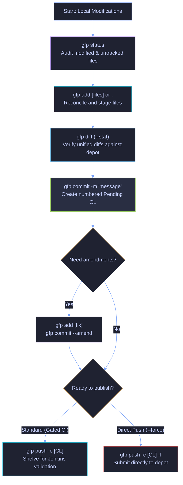
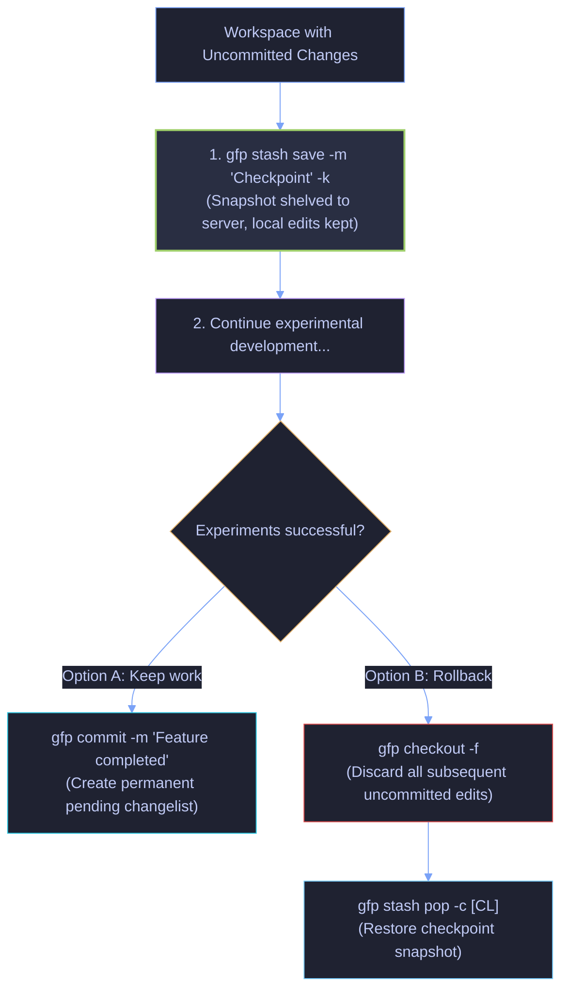
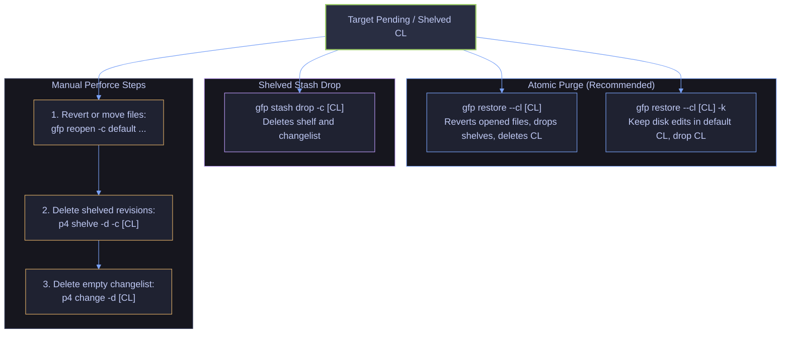
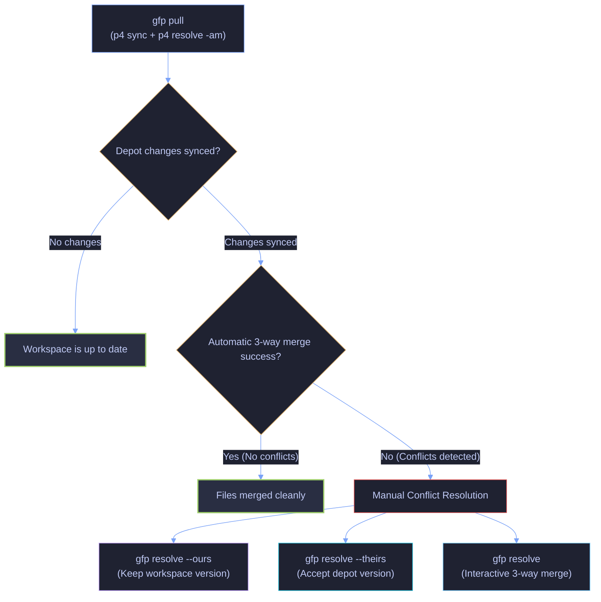
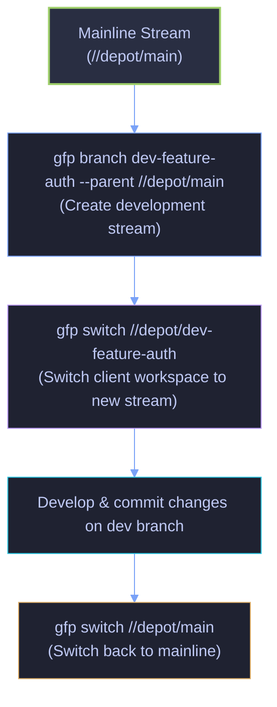
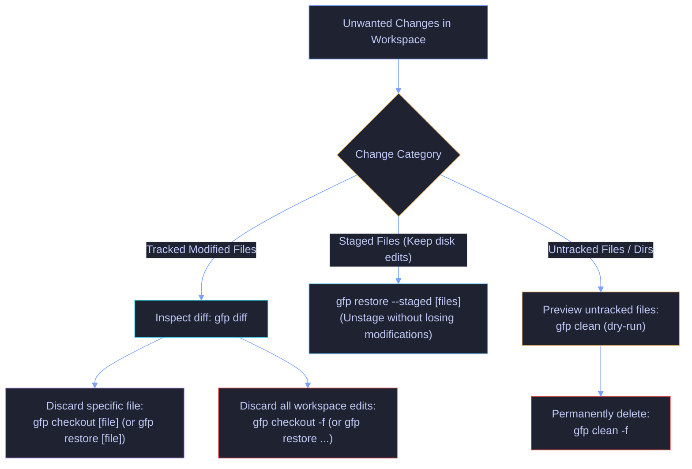

# Everyday Workflows & Mental Models (`README_WORKFLOW.md`)

This guide walks through everyday development workflows using `gfp-cli`, translating familiar Git mental models into native Perforce Helix Core operations.

---

## Navigation & Cross-References

- **Parent Landing Hub:** [`./README.md`](./README.md)
- **Subsystem Gateway (Commands):** [`./commands/README.md`](./commands/README.md)
- **Docker Playground & CI Runbook:** [`./docker/README.md`](./docker/README.md)
- **Test Suite Overview:** [`./tests/README.md`](./tests/README.md)
- **Exhaustive Test Specifications:** [`./tests/TESTS.md`](./tests/TESTS.md)
- **Defect Registry:** [`./BUG-TICKETS.md`](./BUG-TICKETS.md)
- **Coding Invariants:** [`./AGENTS.md`](./AGENTS.md)

---

## Table of Contents

1. [Mental Model: Git vs. Perforce in gfp-cli](#1-mental-model-git-vs-perforce-in-gfp-cli)
2. [Workflow 1: Standard Daily Development Cycle](#2-workflow-1-standard-daily-development-cycle)
3. [Workflow 2: Checkpointing Work-in-Progress (Save & Rollback without Submitting)](#3-workflow-2-checkpointing-work-in-progress-save--rollback-without-submitting)
4. [Workflow 3: Changelist Management & Deletion](#4-workflow-3-changelist-management--deletion)
5. [Workflow 4: Syncing with Remote & Resolving Changes](#5-workflow-4-syncing-with-remote--resolving-changes)
6. [Workflow 5: Stream & Branch Management](#6-workflow-5-stream--branch-management)
7. [Workflow 6: Discarding & Cleaning Workspace Changes](#7-workflow-6-discarding--cleaning-workspace-changes)
8. [Workflow 7: History, Diffs & Code Attribution](#8-workflow-7-history-diffs--code-attribution)
9. [Quick Reference Cheatsheet](#9-quick-reference-cheatsheet)

---

## 1. Mental Model: Git vs. Perforce in gfp-cli

| Concept                | Git Mental Model            | `gfp-cli` / Perforce Implementation                               |
| :--------------------- | :-------------------------- | :---------------------------------------------------------------- |
| **Workspace Staging**  | `git add <files>`           | `gfp add` (`p4 reconcile ...`)                                    |
| **Local Commit**       | `git commit -m "..."`       | `gfp commit` (creates a server-side _Pending Changelist_)         |
| **Push / Submit**      | `git push`                  | `gfp push` (shelves to Jenkins submit-queue or submits with `-f`) |
| **Stash / Checkpoint** | `git stash`                 | `gfp stash` (creates a server-side shelf via `p4 shelve`)         |
| **Discard Edits**      | `git checkout <file>`       | `gfp checkout` (`p4 revert`)                                      |
| **Clean Untracked**    | `git clean -fd`             | `gfp clean -f` (`p4 clean`)                                       |
| **Branches / Streams** | `git branch` / `git switch` | `gfp branch` / `gfp switch` (`p4 streams`, `p4 switch`)           |

```mermaid
%%{init: {
  'theme': 'base',
  'themeVariables': {
    'primaryColor': '#1f2231',
    'primaryTextColor': '#c0caf5',
    'primaryBorderColor': '#27a1b9',
    'lineColor': '#7aa2f7',
    'secondaryColor': '#16161e',
    'tertiaryColor': '#292e42',
    'background': '#1a1b26',
    'mainBkg': '#1f2231',
    'nodeBorder': '#3b4261',
    'clusterBkg': '#16161e',
    'clusterBorder': '#3b4261',
    'titleColor': '#7dcfff',
    'edgeLabelBackground': '#1f2231'
  }
}}%%
flowchart LR
    WT["Working Directory<br/>(Local Modified Files)"]
    ST["Perforce Opened State<br/>(Default Changelist)"]
    CL["Pending Changelist<br/>(Server-Side Private CL)"]
    SQ["Submit Queue / Shelf<br/>(Jenkins Gated CI)"]
    DH["Depot Head<br/>(Committed Mainline)"]

    WT -- "gfp add" --> ST
    ST -- "gfp commit" --> CL
    CL -- "gfp push" --> SQ
    SQ -- "CI Gate Pass / Submit" --> DH
    CL -- "gfp push -f" --> DH

    style WT fill:#1f2231,stroke:#7aa2f7,stroke-width:1px,color:#c0caf5
    style ST fill:#1f2231,stroke:#bb9af7,stroke-width:1px,color:#c0caf5
    style CL fill:#292e42,stroke:#9ece6a,stroke-width:2px,color:#c0caf5
    style SQ fill:#1f2231,stroke:#e0af68,stroke-width:1px,color:#c0caf5
    style DH fill:#1f2231,stroke:#2ac3de,stroke-width:1px,color:#c0caf5
```



> [!NOTE]
> In Perforce, running `gfp commit` creates a **pending changelist** on the Perforce server, but **does not** integrate or submit your changes into the depot revision history. Your work remains completely private until submitted or pushed.

---

## 2. Workflow 1: Standard Daily Development Cycle



### Step 1: Check Workspace Status

```bash
gfp status
```

Displays opened files, pending changelists, and any untracked local additions/modifications.

### Step 2: Stage Your Changes

```bash
# Stage specific files
gfp add src/main.py include/config.h

# Or stage all workspace changes (adds, edits, deletes)
gfp add .
```

### Step 3: Inspect Your Diffs

```bash
# View unified diffs against depot head (colorized automatically in TTY)
gfp diff

# View a git-style summary histogram with colored addition/deletion bars
gfp diff --stat

# Force color or disable color
gfp diff --color
gfp diff --no-color
```

### Step 4: Create a Commit (Pending Changelist)

```bash
gfp commit -m "feat(auth): implement token refresh logic"
```

_Output: `Created pending changelist 1045.`_

### Step 5: (Optional) Amend or Update Commit

If you need to update the commit message or include newly modified files:

```bash
gfp add src/fix.py
gfp commit --amend -m "feat(auth): implement token refresh with retry logic"
```

### Step 6: Push / Submit to Remote

```bash
# Standard workflow: Shelve into Jenkins Gated Submit Queue for CI validation
gfp push -c 1045

# Direct submit (bypass CI gate if permitted):
gfp push -c 1045 --force
```

---

## 3. Workflow 2: Checkpointing Work-in-Progress (Save & Rollback without Submitting)

When you are experimenting or refactoring and want to **snapshot your progress** so you can roll back at any time without submitting to remote:



### 1. Save a Checkpoint & Continue Working

Use `gfp stash save` with the `-k` (`--keep`) flag:

```bash
# Stage untracked/modified files
gfp add .

# Shelve snapshot to server, but KEEP workspace files intact
gfp stash save -m "Checkpoint: feature X before refactoring" -k
```

_This uploads a safe snapshot to the Perforce server as a shelved changelist (e.g. `CL 1050`), while keeping all modified files open and writable in your local workspace._

### 2. View Saved Checkpoints

```bash
# List all your shelved stashes
gfp stash list

# Inspect the diff of a specific checkpoint
gfp stash show -c 1050
```

### 3. Rollback to the Checkpoint (If Experiments Fail)

If your new experiments fail and you want to return to the checkpoint state:

```bash
# Step 1: Discard all subsequent uncommitted local edits
gfp checkout -f

# Step 2: Restore the shelved checkpoint into your workspace
gfp stash pop -c 1050
```

---

## 4. Workflow 3: Changelist Management & Deletion



### How to Delete a Shelved Stash (`CL`)

To remove a shelved changelist created with `gfp stash`:

```bash
# Delete a specific stash
gfp stash drop -c 1050

# Delete the most recent stash
gfp stash drop
```

_This deletes the shelved files (`p4 shelve -d`) and deletes the changelist (`p4 change -d`) in one command._

### How to Delete a Pending Changelist (`CL`)

In Perforce, a changelist cannot be deleted while it still contains opened or shelved files.

1. **Revert or move opened files:**

    ```bash
    # Option A: Discard changes in that CL
    p4 revert -c 1050 ...

    # Option B: Move opened files to default changelist without losing edits
    gfp reopen -c default ...
    ```

2. **Delete any shelved revisions (if applicable):**

    ```bash
    p4 shelve -d -c 1050
    ```

3. **Delete the empty changelist:**
    ```bash
    p4 change -d 1050
    ```

---

## 5. Workflow 4: Syncing with Remote & Resolving Changes



### Sync Latest Revisions

Sync your workspace with the depot and automatically resolve non-conflicting 3-way merges:

```bash
# Standard sync and auto-resolve across entire workspace
gfp pull

# Preview what files would be synced without touching working tree (dry-run)
gfp pull --dry-run

# Force re-sync of files even if already synced at head revision
gfp pull --force

# Scope sync and resolve to a specific directory or files
gfp pull src/engine/ include/
```

_Equivalent to `p4 sync` followed by `p4 resolve -am` (with warning diagnostics for unresolved conflict files)._

### Resolving Conflicts

When conflicts cannot be resolved automatically:

```bash
# Accept your local workspace version
gfp resolve --ours

# Accept depot version, overwriting local changes
gfp resolve --theirs

# Interactive resolution for specific files
gfp resolve src/main.py
```

---

## 6. Workflow 5: Stream & Branch Management



### List Available Streams

```bash
gfp branch
```

Active stream is highlighted with an asterisk `*`.

### Create a New Development Stream

```bash
gfp branch dev-feature-auth --parent //depot/main --type development
```

### Switch Workspace to Another Stream

```bash
# Switch to existing stream
gfp switch //depot/dev-feature-auth

# Switch streams safely with auto-stash (shelves changes, switches stream, and cross-stream unshelves)
gfp switch --stash //depot/dev-feature-auth

# Create and switch in one step
gfp switch -c dev-hotfix-12 --parent //depot/main
```

---

## 7. Workflow 6: Discarding & Cleaning Workspace Changes



### Discard Local Edits (Revert to Depot Head)

```bash
# Discard specific files
gfp checkout src/app.py

# Discard all opened modifications in workspace
gfp checkout

# Force reconcile unopened local edits first, then discard
gfp checkout -f
```

### Remove Untracked Files & Directories

```bash
# Dry-run preview (safe default)
gfp clean

# Permanently delete untracked files and directories
gfp clean -f
```

---

## 8. Workflow 7: History, Diffs & Code Attribution

### Inspect Working Tree Diffs

```bash
# View colorized diff of local modifications
gfp diff

# View diff of specific file or pending changelist
gfp diff src/engine.py
gfp diff -c 1042

# View diffstat summary histogram
gfp diff --stat

# Explicitly control color output
gfp diff --color
gfp diff --no-color
```

### View Commit History

```bash
# View last 10 changelists
gfp log -n 10

# Compact one-line log
gfp log --oneline

# View changelists with full patch diffs
gfp log -p -n 5

# Filter history by author
gfp log --author alice
```

### Inspect Changelists

```bash
# Inspect latest submitted changelist diff and metadata
gfp show

# Inspect specific changelist
gfp show 1042

# View diffstat summary only
gfp show 1042 --stat
```

### Line-by-Line Attribution (Blame)

```bash
# Annotate file
gfp blame src/engine.py

# Annotate specific line range (lines 20 to 50)
gfp blame src/engine.py -L 20,50
```

---

## 9. Quick Reference Cheatsheet

| Task                                   | Command                                           |
| :------------------------------------- | :------------------------------------------------ |
| **Check workspace status**             | `gfp status` (or `gfp st`)                        |
| **Detailed pending CL audit**          | `gfp status -c`                                   |
| **Stage all changes**                  | `gfp add .`                                       |
| **Create pending commit**              | `gfp commit -m "<msg>"` (or `gfp ci -m "<msg>"`)  |
| **Selective file commit**              | `gfp commit <files> -m "<msg>"`                   |
| **Amend commit message/files**         | `gfp commit --amend -m "<msg>"`                   |
| **Unstage files (keep disk edits)**    | `gfp restore --staged [files]`                    |
| **Discard working tree edits**         | `gfp restore [files]` (or `gfp checkout [files]`) |
| **Purge pending changelist & shelves** | `gfp restore --cl <CL>`                           |
| **Diff local modifications**           | `gfp diff` (or `gfp diff --stat`)                 |
| **Diff with color override**           | `gfp diff --color` / `gfp diff --no-color`        |
| **Diff pending changelist**            | `gfp diff -c <CL>` (or `gfp di -c <CL>`)          |
| **Full untruncated history**           | `gfp log -a`                                      |
| **Resolve conflicts (workspace)**      | `gfp resolve --ours [files]`                      |
| **Resolve conflicts (depot)**          | `gfp resolve --theirs [files]`                    |
| **Squash pending changelists**         | `gfp rebase --squash <src> --onto <tgt>`          |
| **Interactive changelist rebase**      | `gfp rebase -i`                                   |
| **Save checkpoint (keep local files)** | `gfp stash save -m "<msg>" -k`                    |
| **Save checkpoint (reset workspace)**  | `gfp stash save -m "<msg>"`                       |
| **List checkpoints**                   | `gfp stash list`                                  |
| **Show checkpoint diff**               | `gfp stash show -c <CL>`                          |
| **Restore checkpoint**                 | `gfp stash pop -c <CL>`                           |
| **Delete checkpoint**                  | `gfp stash drop -c <CL>`                          |
| **Discard all local edits**            | `gfp checkout -f`                                 |
| **Delete untracked files**             | `gfp clean -f`                                    |
| **Pull & resolve from depot**          | `gfp pull`                                        |
| **Preview revisions to sync**          | `gfp pull --dry-run`                              |
| **Sync specific paths**                | `gfp pull <path>`                                 |
| **Switch stream with auto-stash**      | `gfp switch -s <stream>`                          |
| **Submit changelist to CI gate**       | `gfp push -c <CL>`                                |
| **Direct submit to depot**             | `gfp push -c <CL> --force`                        |
