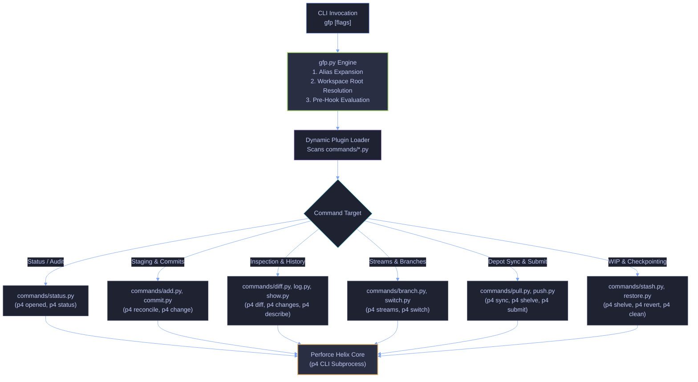

# Subsystem Gateway: Command Plugins (`commands/`)

This directory contains the built-in command plugins for `gfp-cli`. Each module translates Git commands, flags, and mental models into native Perforce Helix Core (`p4`) operations.

---

## Navigation & Cross-References

- **Parent Landing Hub:** [`./../README.md`](./../README.md)
- **Everyday Workflow Guide:** [`./../README_WORKFLOW.md`](./../README_WORKFLOW.md)
- **Test Suite Overview:** [`./../tests/README.md`](./../tests/README.md)
- **Exhaustive Test Specifications:** [`./../tests/TESTS.md`](./../tests/TESTS.md)
- **Defect Registry:** [`./../BUG-TICKETS.md`](./../BUG-TICKETS.md)
- **Coding Invariants:** [`./../AGENTS.md`](./../AGENTS.md)

---

## 1. Architectural Role & Execution Model

The `commands/` directory forms the modular execution tier of `gfp-cli`. Rather than having a monolithic CLI engine, the core driver ([`./../gfp.py`](./../gfp.py)) dynamically scans and imports command plugins at runtime.



---

## 2. The Plugin Contract

Every Python module in `commands/` (or external plugins in `.gfp/commands/`) must strictly implement the standard plugin interface:

```python
# Required: Subcommand name invoked by the user
COMMAND_NAME = "mycmd"

# Required: Single-line help description shown in 'gfp --help'
HELP = "Short summary of what this command does"


# Optional: Register argparse arguments and flags
def setup_parser(parser):
    parser.add_argument("-f", "--flag", action="store_true", help="Flag description")


# Required: Subcommand execution entry point
def execute(args, run_p4, run_cmd=None, to_p4_path=None, **kwargs):
    # args: parsed argparse Namespace
    # run_p4(cmd_list, capture=True, check=True): Perforce execution helper
    # run_cmd(cmd_list, capture=True, check=True): Generic shell command runner
    # to_p4_path(path_str): Path escaping and wildcard translation helper
    # **kwargs: Injected utilities (get_active_stream, run_pager, etc.)
    pass
```

---

## 3. Module Walkthrough & Command Catalog

| Module                               | Command          | Git Equivalent            | Underlying Perforce Operations & Behaviors                                                                                                                      |
| :----------------------------------- | :--------------- | :------------------------ | :-------------------------------------------------------------------------------------------------------------------------------------------------------------- |
| [`./add.py`](./add.py)               | `gfp add`        | `git add <files>`         | Executes `p4 reconcile` across files or directories. Reconciles new files for add, modified files for edit, and deleted files for deletion.                     |
| [`./blame.py`](./blame.py)           | `gfp blame`      | `git blame <file>`        | Runs `p4 annotate` to display line-by-line attribution. Supports line ranges (`-L start,end`), changelist filters (`-c <CL>`), and terminal paging.             |
| [`./branch.py`](./branch.py)         | `gfp branch`     | `git branch`              | Queries and formats `p4 streams`. Highlights active stream with `*`, supports creation (`-c` / `-P` parent), verbose specs (`-v`), and deletion (`-d`).         |
| [`./checkout.py`](./checkout.py)     | `gfp checkout`   | `git checkout <file>`     | Reverts uncommitted files via `p4 revert`. Supports force reconcile prior to reverting (`-f` / `p4 reconcile -w`) to catch unopened edits.                      |
| [`./clean.py`](./clean.py)           | `gfp clean`      | `git clean -fd`           | Removes untracked/unreconciled workspace files via `p4 clean`. Safe dry-run (`-n`) by default; requires `-f` (`--force`) to permanently remove.                 |
| [`./clone.py`](./clone.py)           | `gfp clone`      | `git clone <repo>`        | Clones stream/depot into target directory. Generates client workspace (`allwrite clobber nocompress unlocked`), sets `P4IGNORE`, and runs `p4 sync`.            |
| [`./commit.py`](./commit.py)         | `gfp commit`     | `git commit -m`           | Generates numbered pending changelists via `p4 change -i`. Supports selective commits (`gfp commit file1 file2`), amend (`--amend`), and auto-reconcile (`-a`). |
| [`./completion.py`](./completion.py) | `gfp completion` | N/A                       | Generates dynamic shell completion scripts for Bash, Zsh, and TCSH.                                                                                             |
| [`./diff.py`](./diff.py)             | `gfp diff`       | `git diff`                | Unified diff viewer against depot head (`p4 diff -du`) or changelists (`-c <CL>`). Synthesizes diffs for added files (`/dev/null`), colored output (`--color`), and diffstat (`--stat`).     |
| [`./log.py`](./log.py)               | `gfp log`        | `git log`                 | Changelist history browser (`p4 changes -l`). Supports `--oneline`, full patch diffs (`-p`), author filtering (`-u`), and untruncated depot history (`-a`).     |
| [`./pull.py`](./pull.py)             | `gfp pull`       | `git pull`                | Syncs workspace revisions (`p4 sync`) and automatically 3-way merges non-conflicting edits (`p4 resolve -am`). Warns on conflicts.                              |
| [`./push.py`](./push.py)             | `gfp push`       | `git push`                | Submits pending changelists. Defaults to shelving into the Jenkins gated submit queue (`p4 shelve`). Supports direct bypass submission with `-f` (`p4 submit`). |
| [`./rebase.py`](./rebase.py)         | `gfp rebase`     | `git rebase`              | Consolidates pending changelists (`--squash <src> --onto <tgt>`), reopens files, concatenates descriptions, and deletes source changelists.                     |
| [`./reopen.py`](./reopen.py)         | `gfp reopen`     | `git checkout -b / stage` | Moves opened files between changelists (`p4 reopen -c <CL>`), e.g., moving files from default to a numbered changelist.                                         |
| [`./resolve.py`](./resolve.py)       | `gfp resolve`    | `git checkout --ours`     | Interactive and non-interactive conflict resolution. Accepts `--ours` (`p4 resolve -ay`), `--theirs` (`p4 resolve -at`), or dry-run preview (`-n`).             |
| [`./restore.py`](./restore.py)       | `gfp restore`    | `git restore`             | Unstages files (`--staged` -> `p4 revert -k`), discards working tree edits (`p4 clean -e -d` && `p4 revert`), or atomically purges changelists (`--cl <CL>`).   |
| [`./show.py`](./show.py)             | `gfp show`       | `git show <commit>`       | Inspects submitted or shelved changelists (`p4 describe -du`). Supports shelved changelists (`-S`) and diffstat summaries (`--stat`).                           |
| [`./stash.py`](./stash.py)           | `gfp stash`      | `git stash`               | Manages server-side shelved changelists (`p4 shelve`). Supports `save` (with `-k` keep-workspace flag), `pop`, `list`, `show`, and `drop`.                      |
| [`./status.py`](./status.py)         | `gfp status`     | `git status`              | Audits workspace status: active stream, opened files by changelist (`p4 opened`), and workspace-wide unreconciled files (`p4 reconcile -n -e -a -d -f`) categorized into modified, new/untracked, and deleted files. |
| [`./switch.py`](./switch.py)         | `gfp switch`     | `git switch <branch>`     | Switches client workspace stream (`p4 switch`). `-s` (`--stash`) automatically shelves workspace edits, switches stream, and cross-stream unshelves back.       |

---

## 4. Development & Unit Testing

When developing or modifying command modules:

1. **Maintain Python 3.6.4+ Compatibility:** Avoid Python 3.7+ exclusive features (`capture_output=True`, `dataclasses`).
2. **Path Sanitization:** Always process file arguments using `to_p4_path()` to handle Perforce special characters (`@`, `#`, `%`, `*`) and translate directory paths into `...`.
3. **Execute Unit Tests:**
    ```bash
    python3 tests/run_tests.py -k "test_commands"
    ```
