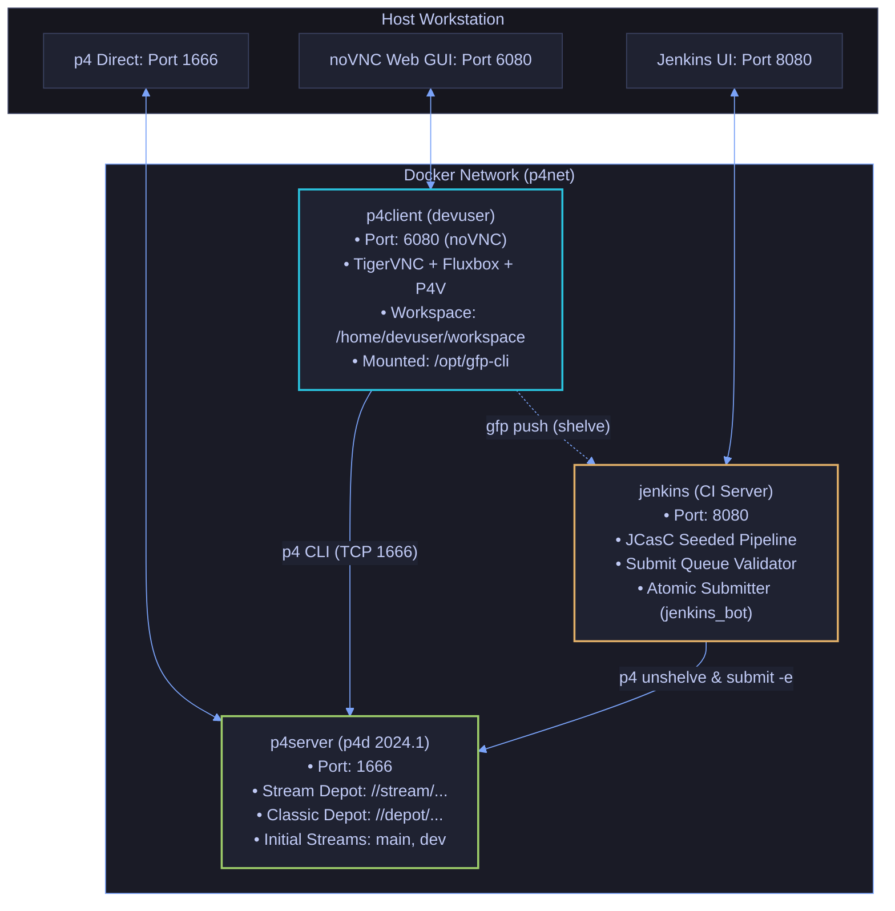

# Subsystem Gateway & Toolchain Runbook: Docker Playground (`docker/`)

This directory provides a self-contained containerized playground for experimenting with Perforce Helix Core (`p4d`), the Perforce Visual Client (`p4v`), Jenkins Configuration as Code (JCasC), and verifying the `gfp-cli` command translation layer.

---

## Navigation & Cross-References

- **Parent Landing Hub:** [`./../README.md`](./../README.md)
- **Subsystem Gateway (Commands):** [`./../commands/README.md`](./../commands/README.md)
- **Test Suite Overview:** [`./../tests/README.md`](./../tests/README.md)
- **Exhaustive Test Specifications:** [`./../tests/TESTS.md`](./../tests/TESTS.md)
- **Defect Registry:** [`./../BUG-TICKETS.md`](./../BUG-TICKETS.md)
- **Coding Invariants:** [`./../AGENTS.md`](./../AGENTS.md)

---

## 1. Container Network & Service Architecture

The playground is orchestrated via Docker Compose, provisioning three networked containers over an isolated bridge network (`p4net`):



---

## 2. Host Prerequisites & Multi-Distro Setup

The container environment requires Docker Engine and Docker Compose (v2+).

### Debian / Ubuntu Installation

```bash
sudo apt-get update
sudo apt-get install -y docker.io docker-compose-plugin make
sudo systemctl enable --now docker
sudo usermod -aG docker $USER
# Log out and back in for docker group permissions
```

### Fedora / RHEL / CentOS Installation

```bash
sudo dnf install -y docker docker-compose-plugin make
sudo systemctl enable --now docker
sudo usermod -aG docker $USER
```

---

## 3. Quick Start Runbook

### Step 1: Initialize the Stack

```bash
cd docker
make up
```

This bootstrap sequence performs the following:

1. Builds container images (`p4server`, `p4client`, and `jenkins`).
2. Bootstraps Perforce Helix Core (`p4d`) with stream depots (`//stream/...`) and initial branches (`//stream/main`, `//stream/dev`).
3. Provisions the client workspace `devuser_ws` mapped to `/home/devuser/workspace`.
4. Starts TigerVNC and the noVNC HTML5 bridge.
5. Seeds the Jenkins controller with the `gfp-submit-queue` pipeline via Jenkins Configuration as Code ([`./jenkins_config/jenkins.yaml`](./jenkins_config/jenkins.yaml)).

### Step 2: Access Endpoints

| Endpoint                    | Command / URL                                  | Credentials & Notes                                                      |
| :-------------------------- | :--------------------------------------------- | :----------------------------------------------------------------------- |
| **Client Shell (CLI)**      | `make client-cli`                              | Spawns bash in `/home/devuser/workspace` with `gfp` and `p4` configured. |
| **Web GUI (noVNC)**         | `http://localhost:6080` (or `make client-gui`) | **Password:** `Et2024tE`. Desktop environment with P4V shortcut.         |
| **Jenkins CI Dashboard**    | `http://localhost:8080` (or `make ci-ui`)      | Pre-configured Gated Submit Queue Pipeline (`gfp-submit-queue`).         |
| **Trigger CI Verification** | `make ci-trigger CL=<ID>`                      | Dispatches shelved changelist to Jenkins queue.                          |
| **Stream CI Logs**          | `make ci-logs`                                 | Follows stdout/stderr from Jenkins container.                            |
| **Host p4 Connection**      | `p4 -p localhost:1666 -u devuser info`         | Direct TCP connection from host utilities.                               |
| **Server Shell**            | `make server-cli`                              | Enters bash in `p4server` container.                                     |

---

## 4. Running Automated Tests

Run the test suite directly from the host machine:

```bash
# Run unit tests and all 36 E2E integration tests
make test

# Run only Python unit tests (fast, no daemon needed)
make unit-test

# Filter E2E tests by regular expression
make test ARGS="-k 'stash|switch'"

# Run with verbose output
make test ARGS="--verbose"
```

Or execute directly inside the client container (`make client-cli`):

```bash
gfp-test
# or: bash /opt/gfp-cli/tests/test_gfp.sh [OPTIONS]
# or: python3 /opt/gfp-cli/tests/run_tests.py
```

---

## 5. Makefile Target Catalog

| Target                      | Description                                                               | Flags / Parameters              |
| :-------------------------- | :------------------------------------------------------------------------ | :------------------------------ |
| `make up`                   | Starts all three containers in background mode.                           | None                            |
| `make down`                 | Stops and removes container instances.                                    | None                            |
| `make restart`              | Restarts all running containers.                                          | None                            |
| `make build`                | Rebuilds container images from scratch without layer cache.               | None                            |
| `make logs`                 | Tails aggregated logs from all running containers.                        | None                            |
| `make status`               | Audits container lifecycle state and port forward mappings.               | None                            |
| `make client-cli`           | Spawns an interactive bash shell in the client workspace.                 | None                            |
| `make server-cli`           | Spawns an interactive bash shell on the Perforce server.                  | None                            |
| `make client-gui`           | Launches default browser pointing to noVNC GUI (`http://localhost:6080`). | None                            |
| `make test`                 | Executes unit and E2E integration test suite inside client.               | `ARGS="--unit\|-k <regex>\|-v"` |
| `make unit-test`            | Runs standalone Python unit tests only.                                   | None                            |
| `make ci-ui`                | Opens browser pointing to Jenkins Web UI (`http://localhost:8080`).       | None                            |
| `make ci-logs`              | Tails log output from Jenkins container.                                  | None                            |
| `make ci-trigger`           | Dispatches changelist to the Jenkins submit-queue job.                    | `CL=<changelist_id>`            |
| `make clean`                | Removes orphan containers and temporary compose volumes.                  | None                            |
| `make rmi`                  | Prunes built project container images.                                    | None                            |
| `make distclean`            | Complete environment reset: removes images, volumes, and workspaces.      | None                            |
| `make docker-engine-start`  | Starts host system Docker daemon (`systemctl start docker`).              | None                            |
| `make docker-engine-stop`   | Stops host system Docker daemon (`systemctl stop docker`).                | None                            |
| `make docker-engine-status` | Audits host system Docker service status.                                 | None                            |
