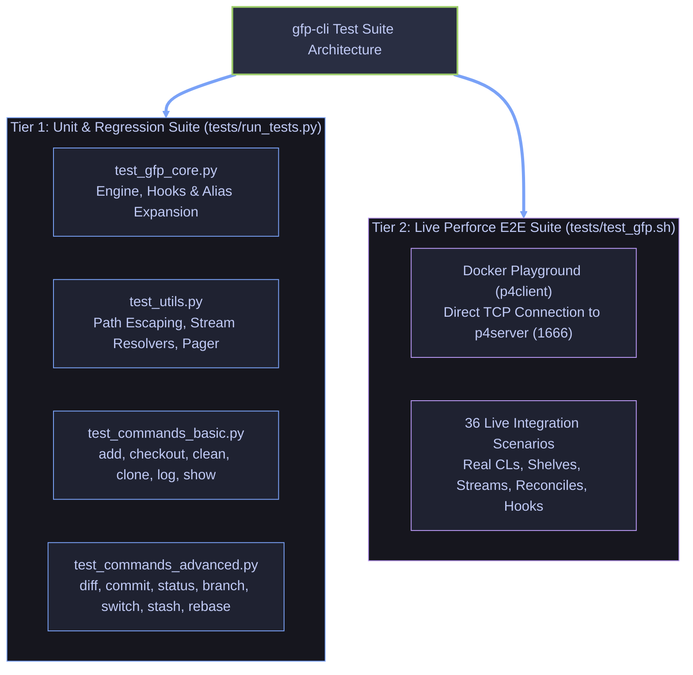

# Subsystem Gateway & Test Strategy: `gfp-cli` Test Suite (`tests/`)

This directory contains the automated test suites for `gfp-cli`, covering both standalone Python unit/regression tests and full end-to-end (E2E) integration tests running against a live Perforce Helix Core server.

---

## Navigation & Cross-References

- **Parent Landing Hub:** [`./../README.md`](./../README.md)
- **Subsystem Gateway (Commands):** [`./../commands/README.md`](./../commands/README.md)
- **Exhaustive Test Specifications (Test Catalog):** [`./TESTS.md`](./TESTS.md)
- **Defect Registry:** [`./../BUG-TICKETS.md`](./../BUG-TICKETS.md)
- **Everyday Workflow Guide:** [`./../README_WORKFLOW.md`](./../README_WORKFLOW.md)
- **Docker Playground & CI Runbook:** [`./../docker/README.md`](./../docker/README.md)
- **Coding Invariants:** [`./../AGENTS.md`](./../AGENTS.md)

---

## 1. Overview & Test Architecture

The `gfp-cli` testing strategy is divided into two distinct testing tiers:



---

## 2. Directory Layout

```text
tests/
├── README.md                  # Test suite overview and guide
├── TESTS.md                   # Exhaustive test-by-test specifications (Goal, Description, Flow, Check)
├── __init__.py                # Package initialization for test discovery
├── run_tests.py               # Standalone Python unit test runner with regex filtering
├── test_utils.py              # Unit tests for utils.py (escaping, resolvers, pager)
├── test_gfp_core.py           # Unit tests for gfp.py (engine, hook dispatch, plugins)
├── test_commands_basic.py     # Unit tests for basic command modules
├── test_commands_advanced.py  # Unit tests for advanced command modules & diffstat
└── test_gfp.sh                # End-to-end automated integration test suite (36 scenarios)
```

> [!NOTE]
> For an exhaustive, test-by-test verification catalog detailing the exact **Goal**, **Description**, **Test-Flow**, and **Check** criteria for every test scenario, refer to [`./TESTS.md`](./TESTS.md).

---

## 3. Unit & Regression Test Suite

### 3.1 Design Principles & Compatibility

- **Zero External Perforce Dependency:** Executes entirely within the standard library (`unittest`, `unittest.mock`) without requiring a live `p4d` daemon or configured Perforce credentials.
- **Python 3.6.4+ Invariant:** Strictly compatible with Python 3.6.4 through Python 3.14+.
- **Subprocess Isolation:** Command modules validate argument parser configuration and Perforce translation via injected `run_p4` and `run_cmd` mocks.

### 3.2 Test Modules Breakdown

| Test File                                                    | Target Modules                     | Key Behaviors & Invariants Tested                                                                                                                                                                                                                                                                                                                                                                                                                                                                                                                                                                                                                                                                                                                                                                                                                                                                                                                                                                                                                                                                                                                                                                     |
| :----------------------------------------------------------- | :--------------------------------- | :---------------------------------------------------------------------------------------------------------------------------------------------------------------------------------------------------------------------------------------------------------------------------------------------------------------------------------------------------------------------------------------------------------------------------------------------------------------------------------------------------------------------------------------------------------------------------------------------------------------------------------------------------------------------------------------------------------------------------------------------------------------------------------------------------------------------------------------------------------------------------------------------------------------------------------------------------------------------------------------------------------------------------------------------------------------------------------------------------------------------------------------------------------------------------------------------------- |
| [`./test_utils.py`](./test_utils.py)                         | [`./../utils.py`](./../utils.py)   | • Perforce special character escaping (`@` &rarr; `%40`, `#` &rarr; `%23`, `%` &rarr; `%25`, `*` &rarr; `%2A`) with ordered substitution.<br>• Path unescaping and normalization (`unescape_p4_path`, `to_p4_path`).<br>• Stream path resolution (`resolve_stream_path`).<br>• Active client, user, port, and stream resolvers.<br>• Workspace root discovery via `.gfp` marker or `p4 info`.<br>• Terminal pager invocation (`run_pager`) and pipe-signal handling (`SIGPIPE`, `KeyboardInterrupt`).                                                                                                                                                                                                                                                                                                                                                                                                                                                                                                                                                                                                                                                                                                 |
| [`./test_gfp_core.py`](./test_gfp_core.py)                   | [`./../gfp.py`](./../gfp.py)       | • Core command execution runners (`run_cmd`, `run_p4`).<br>• Lifecycle hook discovery (`pre-*`, `post-*` in `.gfp/hooks` or `~/.gfp/hooks`).<br>• Lifecycle hook execution and abort enforcement on non-zero exit codes.<br>• Hook environment variable propagation (`GFP_COMMAND`, `GFP_HOOK_STAGE`, `GFP_WORKSPACE_ROOT`, `GFP_ARGS`).<br>• Command alias expansion (`ci` &rarr; `commit`, `st` &rarr; `status`, `co` &rarr; `checkout`, `br` &rarr; `branch`, `di` &rarr; `diff`, `sw` &rarr; `switch`).<br>• External declarative JSON plugin discovery (`plugins.json`).                                                                                                                                                                                                                                                                                                                                                                                                                                                                                                                                                                                                                         |
| [`./test_commands_basic.py`](./test_commands_basic.py)       | [`./../commands/`](./../commands/) | • `add.py`: `gfp add` file staging, `--all`, `--update` (`-u`), wildcard handling.<br>• `checkout.py`: `gfp checkout` discard changes, `--force` (`-f`).<br>• `clean.py`: `gfp clean` untracked file removal, `-n` dry-run, `-f -d` force removal.<br>• `clone.py`: `gfp clone` stream cloning, directory creation, client workspace initialization.<br>• `blame.py`: `gfp blame` line attribution (`p4 annotate`).<br>• `log.py`: `gfp log` changelist history, `-n` limits, `-a` all streams.<br>• `show.py`: `gfp show` changelist details (`p4 describe -du`).<br>• `completion.py`: `gfp completion` shell completions for `bash`, `zsh`, `tcsh`.                                                                                                                                                                                                                                                                                                                                                                                                                                                                                                                                                |
| [`./test_commands_advanced.py`](./test_commands_advanced.py) | [`./../commands/`](./../commands/) | • `diff.py`: Opened file parsing, unified diffs, pending CL diffing (`-c`), and diffstat histogram generation (`--stat`).<br>• `commit.py`: Changelist creation, amend description & reopen (`--amend`), auto-reconcile (`-a`), selective file staging.<br>• `status.py`: Workspace status audit, grouped changelists, untracked file detection, `-c` pending changelist audit.<br>• `branch.py`: Stream listing, creation (`-c`), verbose details (`-v`), deletion (`-d`).<br>• `switch.py`: Stream switching, cross-stream auto-stashing (`-s`), shelf restoration.<br>• `stash.py`: `save`, `list`, `pop`, `show`, `drop` workflows.<br>• `rebase.py`: Squashing pending changelists (`--squash <src> --onto <tgt>`).<br>• `reopen.py`: Moving opened files between numbered pending changelists and the default changelist.<br>• `resolve.py`: Conflict resolution (`--ours`, `--theirs`, `-n` dry-run).<br>• `restore.py`: Working tree discard, `--staged` unstaging, `--cl` changelist purging.<br>• `pull.py`: Sync depot revisions, force re-sync (`-f`), dry-run preview (`-n`), auto-merge safe conflicts (`-am`).<br>• `push.py`: Gated submit queue shelving vs force submission (`-f`). |

### 3.3 Running Unit Tests

Execute the unit test suite via `make` or directly using Python / Pytest:

```bash
# Via root Makefile (recommended)
make test-unit

# With test filter
make test-unit TEST_FILTER="utils"
# Or single test target
make test-single TEST_NAME="test_commit"

# Directly with Python test runner
python3 tests/run_tests.py

# Run with verbose output
python3 tests/run_tests.py -v

# Run filtered tests matching a regex pattern
python3 tests/run_tests.py -k "utils|commit"
python3 tests/run_tests.py -k "TestCommandDiff"

# Via pytest
pytest
```

---

## 4. End-to-End Automated Integration Test Suite (`test_gfp.sh`)

### 4.1 Execution Environment

The E2E test suite executes inside the Docker Playground client container (`p4client`) with direct network access to the Perforce Helix Core server (`p4server`).

### 4.2 Test Scenarios

The suite validates 36 scenarios:

|   #    | Scenario Name                     | Test Description & Verified Invariants                                                                       |
| :----: | :-------------------------------- | :----------------------------------------------------------------------------------------------------------- |
| **1**  | `CLI Engine & Help`               | Verifies `gfp --help` displays all core subcommands and registered aliases.                                  |
| **2**  | `Clean Workspace Status`          | Verifies `gfp status` reports clean state when no files are modified.                                        |
| **3**  | `Add & Status`                    | Verifies `gfp add` stages new and modified files via `p4 reconcile`.                                         |
| **4**  | `Unified Diff`                    | Verifies `gfp diff` outputs valid unified diff format against depot head.                                    |
| **5**  | `Commit (New CL)`                 | Verifies `gfp commit -m "..."` creates a numbered pending changelist.                                        |
| **6**  | `Commit Amend`                    | Verifies `gfp commit --amend` updates changelist description and reopens newly staged files.                 |
| **7**  | `Show Details`                    | Verifies `gfp show <CL>` outputs changelist description, metadata, and unified diff.                         |
| **8**  | `Push (CI Shelve & Force Submit)` | Verifies `gfp push` shelves for CI submit queue and `gfp push -f` directly submits to depot.                 |
| **9**  | `Log History`                     | Verifies `gfp log` lists committed changelists in reverse chronological order.                               |
| **10** | `Blame Attribution`               | Verifies `gfp blame <file>` displays line-by-line Perforce annotations.                                      |
| **11** | `Stash Workflow`                  | Verifies `gfp stash save`, `list`, `show`, and `pop` restore modified state from shelves.                    |
| **12** | `Branch Overview`                 | Verifies `gfp branch` lists streams and highlights active stream with an asterisk.                           |
| **13** | `Switch Stream`                   | Verifies `gfp switch <stream>` switches the client workspace stream target.                                  |
| **14** | `Checkout & Clean`                | Verifies `gfp checkout` reverts modified files and `gfp clean` removes untracked files.                      |
| **15** | `Lifecycle Hooks`                 | Verifies `pre-commit` and `post-commit` hook execution, environment variables, and abort on failure.         |
| **16** | `Autocompletion`                  | Verifies `gfp completion <shell>` emits valid Bash, Zsh, and TCSH scripts.                                   |
| **17** | `Clone Workflow`                  | Verifies `gfp clone <stream> <dir>` creates workspace, sets options, and syncs files.                        |
| **18** | `Command Aliases`                 | Verifies built-in aliases (`st`, `ci`, `co`, `br`, `di`, `sw`) dispatch to target commands.                  |
| **19** | `Full Log History`                | Verifies `gfp log -a` lists changelists across all depot streams.                                            |
| **20** | `Pending CL Status`               | Verifies `gfp status -c` audits pending changelists, opened files, and shelves.                              |
| **21** | `Selective File Commit`           | Verifies `gfp commit <file> -m "..."` opens only specified files into the pending changelist.                |
| **22** | `Restore Workflow`                | Verifies `gfp restore --staged` unstages files without discarding changes, and `--cl` purges changelists.    |
| **23** | `Pending CL Diff`                 | Verifies `gfp diff -c <CL>` diffs opened files belonging to a specific pending changelist.                   |
| **24** | `Rebase Squash`                   | Verifies `gfp rebase --squash <src> --onto <tgt>` consolidates files and changelist descriptions.            |
| **25** | `Pull Workflow`                   | Verifies `gfp pull` syncs depot changes and automatically resolves safe edits (`-am`).                       |
| **26** | `Resolve Conflicts`               | Verifies `gfp resolve` with `--ours`, `--theirs`, and preview dry-run (`-n`).                                |
| **27** | `Reopen Workflow`                 | Verifies `gfp reopen -c <CL> <file>` relocates opened files between pending changelists.                     |
| **28** | `Branch Lifecycle`                | Verifies stream creation (`gfp branch -c`), verbose details (`-v`), and deletion (`-d`).                     |
| **29** | `Cross-Stream Auto-Stash`         | Verifies `gfp switch -s` shelves workspace-wide changes, switches stream, and unshelves onto the new stream. |
| **30** | `Diffstat Summary`                | Verifies `gfp diff --stat` generates file histograms, inserted/deleted counts, and summary totals.           |
| **31** | `Clean Dry-Run vs Force`          | Verifies `gfp clean -n` reports untracked files safely without deletion, and `-f -d` deletes them.           |
| **32** | `Commit Auto-Reconcile`           | Verifies `gfp commit -a -m "..."` automatically reconciles modified files before committing.                 |
| **33** | `Stash Drop & Show`               | Verifies `gfp stash show stash@{N}` diff inspection and `gfp stash drop stash@{N}` shelf deletion.           |
| **34** | `Special Character Escaping`      | Verifies files containing `@`, `#`, `%`, `*` can be added, diffed, committed, and reverted safely.           |
| **35** | `Declarative JSON Plugins`        | Verifies custom subcommands defined in `.gfp/plugins.json` are discovered and executed.                      |
| **36** | `Deep Workspace Resolution`       | Verifies running `gfp` from deeply nested subdirectories correctly finds the workspace root.                 |

### 4.3 Running the Integration Test Suite

From the repository root via [`./../Makefile`](./../Makefile) or directly via [`./../docker/Makefile`](./../docker/Makefile):

```bash
# Via root Makefile
make test-e2e

# Run all test stages sequentially (Unit then E2E)
make test-all

# Via docker Makefile directly:
# Run both Unit and all 36 E2E integration tests
make -C docker test

# Run only E2E tests matching a regex pattern
make -C docker test ARGS="-k 'stash|switch'"

# Run with verbose output
make -C docker test ARGS="--verbose"
```

Inside the client container (`make -C docker client-cli`):

```bash
# Using the pre-configured CLI helper
gfp-test

# Or invoking the script directly with options
bash /opt/gfp-cli/tests/test_gfp.sh --e2e
bash /opt/gfp-cli/tests/test_gfp.sh -k "diff|commit" -v
```

---

## 5. Adding New Tests

### 5.1 Adding Unit Tests

1. For core functionality or utilities, add test methods to [`./test_utils.py`](./test_utils.py) or [`./test_gfp_core.py`](./test_gfp_core.py).
2. For command plugins, add test cases to [`./test_commands_basic.py`](./test_commands_basic.py) or [`./test_commands_advanced.py`](./test_commands_advanced.py).
3. Ensure no external Perforce daemon is required; mock all `run_p4` and `run_cmd` calls.

### 5.2 Adding End-to-End Scenarios

1. Open [`./test_gfp.sh`](./test_gfp.sh).
2. Define a new test function `test_XX_feature_name()`.
3. Use the isolated `reset_workspace` helper before and after changes.
4. Register the test function call inside `main()` with `run_test "Feature Description" test_XX_feature_name`.
